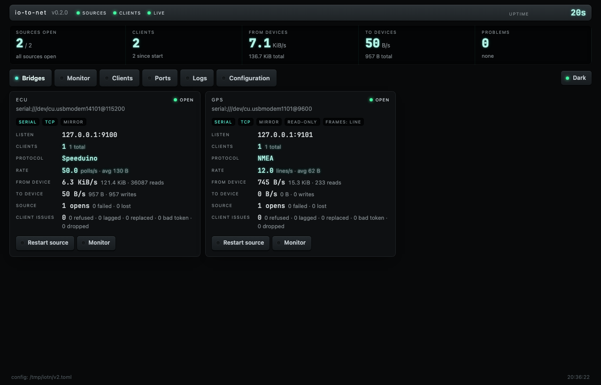
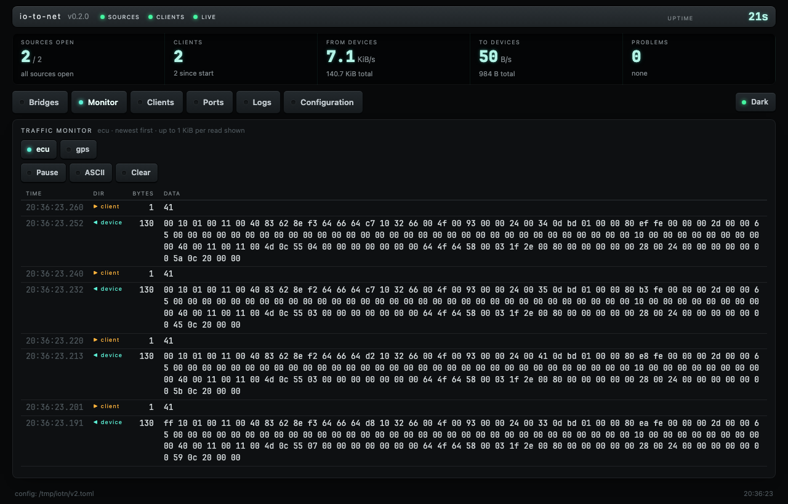
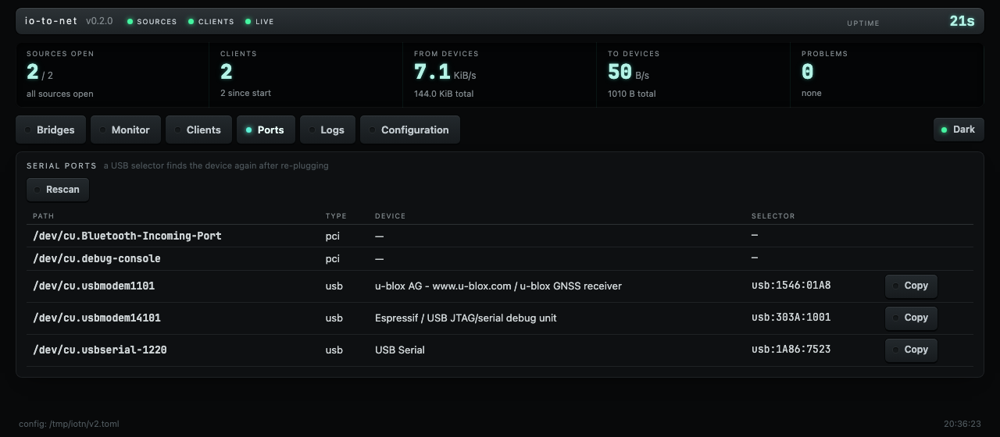
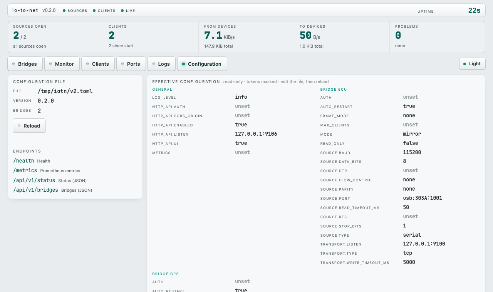

# io-to-net

**io-to-net** exposes local hardware to the network. Serial ports, SocketCAN,
I²C, GPIO, 1-Wire and BLE devices become TCP, TLS or WebSocket servers, and
the bytes pass through unchanged. A client on another machine talks to the
device as if it were plugged in locally.

```
device ── serial / CAN / I²C / GPIO / BLE ──► io-to-net ── TCP · TLS · WebSocket ──► clients
```


It is built for request–reply devices such as ECUs, GPS receivers, MODBUS and
AT modems, and for streams with several readers. A Speeduino polled through
io-to-net answers as fast as over a direct USB connection: 50 Hz with 13.9 ms
per poll, measured with ecu-to-mqtt over TCP. io-to-net 0.1 managed 9 Hz.

| Bridges | Traffic monitor |
|---|---|
|  |  |
|  |  |

## Features

**Sources**

| Type | Platforms | Notes |
|---|---|---|
| `serial` | all | Paths or USB selectors that survive re-plugging (`usb:VID:PID[:SERIAL]`, `usb:name=…`), DTR/RTS control |
| `tcp_client` | all | A Wi-Fi serial adapter, an [ESP node](firmware/) or another io-to-net |
| `pty` | Unix | Virtual serial port for local programs, with a symlink |
| `unix_socket` | Unix | |
| `canbus` | Linux | SocketCAN as JSON lines (the ecu-to-mqtt gateway format), slcan or binary `can_frame`; filters; clients can transmit |
| `i2c` | Linux | Polled reads with init writes and a register select |
| `gpio` | Linux | Edge events, one byte each |
| `onewire` | Linux | w1 sysfs readings |
| `bluetooth` | Linux, macOS, Windows | BLE GATT notifications in, writes out |

**Transports:** `tcp`, `tls` (rustls, optional client certificates) and
`web_socket` (binary messages; text messages are accepted).

**Bridging**
- Full duplex: a client's request goes to the device the moment it arrives.
- `mirror` mode fans the stream out to every client. `exclusive` mode lets a
  new client replace the old one, for pollers and tools like TunerStudio.
- `read_only`, `max_clients`, and a per-bridge token sent as the first line.
- A slow client is disconnected; it never stalls the device or other clients.
- Clients stay connected while a source is unplugged or reconnecting. Retries
  back off from 1 s to 30 s.
- Frame modes: `line` (NMEA and AT, one message per line on WebSocket),
  `null_terminated` (COBS) and `length_prefix`.

**Operations**
- Live reload with `systemctl reload`, SIGHUP, the API or the dashboard.
  Unchanged bridges keep their clients.
- Web dashboard: bridges, a hex/ASCII traffic monitor, clients, a serial port
  scan with selectors, logs and the configuration, in light and dark themes.
- Terminal dashboard (`r` restarts a source, `R` reloads).
- HTTP API, Prometheus `/metrics` and `/health`, plus `--healthcheck`,
  `--check-config` and `--scan`.
- Passive protocol detection: NMEA, AT, SCPI, slcan, SLIP, COBS, MAVLink and
  MODBUS RTU. Speeduino and MegaSquirt are recognised from their polls.
- Hardened systemd unit, deb/rpm packages (x86-64 and arm64), Windows zip,
  macOS tarballs and Homebrew.

## Install

```bash
# Debian / Ubuntu / Raspberry Pi OS (amd64, arm64)
sudo apt install ./io-to-net_0.2.0_arm64.deb
# Fedora / RHEL
sudo dnf install ./io-to-net-0.2.0-1.aarch64.rpm
# macOS
brew install askrejans/g86racing/io-to-net
# From source (Rust 1.89+; Linux BLE needs libdbus-1-dev)
cargo install --path .                       # or: --no-default-features (no BLE)
```

Packages are on the [releases page](https://github.com/askrejans/io-to-net/releases).
The deb/rpm installs `/etc/io-to-net/config.toml`, a hardened
`io-to-net.service`, and a service user in the `dialout`, `tty`, `gpio`,
`i2c` and `bluetooth` groups (whichever of them exist).

## Quick start

```bash
io-to-net --scan                  # serial ports with their USB selectors
$EDITOR /etc/io-to-net/config.toml
io-to-net --check-config
sudo systemctl enable --now io-to-net
open http://127.0.0.1:9106/       # dashboard
```

Or run it in a terminal with the TUI: `io-to-net -c config.toml`.

A minimal config: a Speeduino on USB for TunerStudio or ecu-to-mqtt, and a
u-blox GPS as one NMEA sentence per frame.

```toml
[[bridges]]
name = "ecu"
mode = "exclusive"                     # one poller at a time; a new one takes over
[bridges.source]
type = "serial"
port = "usb:303A:1001"                 # or /dev/ttyACM0, COM3
baud = 115200
[bridges.transport]
type = "tcp"
listen = "[::]:9000"

[[bridges]]
name = "gps"
read_only = true
frame_mode = "line"
[bridges.source]
type = "serial"
port = "usb:1546:01A8"
baud = 9600
[bridges.transport]
type = "tcp"
listen = "[::]:9001"
```

Then point the clients at it:

```bash
ECU_TO_MQTT_CONNECTION_TYPE=tcp ECU_TO_MQTT_TCP_HOST=pi.local ECU_TO_MQTT_TCP_PORT=9000 ecu-to-mqtt
GPS_TO_MQTT_CONNECTION_TYPE=tcp GPS_TO_MQTT_TCP_HOST=pi.local GPS_TO_MQTT_TCP_PORT=9001 gps-to-mqtt
nc pi.local 9001                       # raw NMEA
```

[config/example.toml](config/example.toml) has a commented example of every
source and transport. The tests check that each of them parses.

## Configuration reference

| Key | Default | Meaning |
|---|---|---|
| `log_level` | `info` | `trace` … `error`; `--log-level` and `IO_TO_NET_LOG_LEVEL` override it |
| `[http_api]` `enabled`, `listen`, `ui` | `true`, `127.0.0.1:9106`, `true` | API, dashboard and `/metrics` |
| `[http_api.auth] token` | none | Bearer token for `/api/*` |
| `[http_api] cors_origin` | none | For dashboards on another origin |
| `[metrics]` `enabled`, `listen` | off | Extra Prometheus-only listener |
| `[[bridges]] name` | required | Letters, digits, `-`, `_`, `.` |
| `mode` | `mirror` | `mirror` or `exclusive` |
| `read_only` | `false` | Ignore client writes |
| `max_clients` | unlimited | Mirror mode limit |
| `auto_restart` | `true` | Reopen the source after failures |
| `frame_mode` | `none` | `none`, `line`, `null_terminated` or `length_prefix` |
| `[bridges.auth] token` | none | First line a client must send |
| `[bridges.source] type` | required | See the sources table above and the example config |
| `[bridges.transport] type`, `listen`, `write_timeout_ms` | required, required, `5000` | `tcp`, `tls` (`cert`, `key`, `client_ca`) or `web_socket` |

Unknown keys are errors, so typos don't fail silently. Run
`io-to-net --check-config` to validate a file.

## Security

- The API listens on loopback by default. Before binding it elsewhere, set
  `[http_api.auth]`. Restart and reload need an `X-Requested-With` header, so a
  web page in a browser can't trigger them.
- Bridge listeners have no protection apart from an optional token and TLS.
  Listen on a private interface, or use `tls` with `client_ca` for mutual TLS.
- The dashboard has a strict CSP: no inline script, no remote resources, and
  configuration is read-only. Tokens are masked in `/api/v1/config`.
- The systemd unit runs as an unprivileged user with no capabilities, a
  read-only system, a syscall filter and limited address families.

## HTTP API

| Route | |
|---|---|
| `GET /health` | `200 ok` when every source is open, `503 degraded` otherwise (open even with a token) |
| `GET /metrics` | Prometheus text (`io_to_net_bridge_*`) |
| `GET /api/v1/status` | Version, uptime, config path, all bridges |
| `GET /api/v1/bridges`, `/api/v1/bridges/{name}` | Status, rates, counters and clients |
| `GET /api/v1/bridges/{name}/monitor?after=<seq>` | Recent traffic as hex, both directions |
| `POST /api/v1/bridges/{name}/restart` | Reopen the source; clients stay connected |
| `POST /api/v1/reload` | Re-read the config file; a bad file is rejected and the running bridges are kept |
| `GET /api/v1/logs?n=200`, `/api/v1/config`, `/api/v1/ports` | Log tail, masked config, serial port scan |
| `GET /api/v1/stream` | Server-sent events: `status` once a second |

## Other tools

| | |
|---|---|
| `io-to-net generate-cert --out DIR --cn HOST` | Self-signed certificate for `tls` |
| `io-to-net --scan [--deep] [--json]` | Serial ports (with selectors), I²C buses, GPIO chips, BLE devices |
| `io-to-net --healthcheck` | Exit status from `/health` (for Docker and monitoring) |
| [firmware/](firmware/) | ESP32 / ESP32-S3 / ESP8266 node exposing a UART, I²C and GPIO over Wi-Fi |

## Documentation

- [TECHNICAL.md](TECHNICAL.md): architecture, data path, measurements,
  0.2 review findings, metrics.
- [CHANGELOG.md](CHANGELOG.md)
- [AGENTS.md](AGENTS.md): contributor and agent guide.

## Licence

GPL-3.0-only ([LICENCE](LICENCE)), with the
[AI training restriction](AI_TRAINING_RESTRICTION.md).
